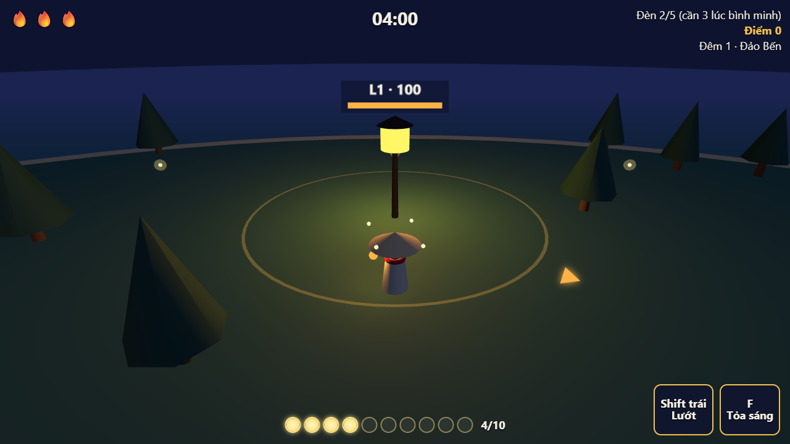

# Đảo Đèn Lồng

> **Video demo:** [demo.mp4](https://github.com/DaoHuyPJ/K5-L3A-DAY12-DaoQuangHuy-2A202603642-AI-SDLC-Dao-Den-Long/releases/download/v1.0.0/demo.mp4) (< 5 phút, đính kèm Release `v1.0.0`) · **Bản chạy được:** [Release v1.0.0](https://github.com/DaoHuyPJ/K5-L3A-DAY12-DaoQuangHuy-2A202603642-AI-SDLC-Dao-Den-Long/releases/tag/v1.0.0) → `dao-den-long-v1.0.0-web.zip`



Game 3D góc nhìn thứ ba (Three.js, chạy trên trình duyệt), 3 Đêm, + chế độ headless, benchmark và soak test theo **Test Contract v1.3**.
Mây, người giữ đèn nhỏ tuổi đội nón lá, gom đom đóm để thắp và **giữ cho các Đèn Lồng Lớn còn sáng tới bình minh** — đèn cạn dầu sẽ tắt, Bóng Mực hút dầu đèn yếu.

Bài lab Day 12 AI SDLC — đề bài gốc ở [docs/lab/](docs/lab/README.md) và lab board.

## Yêu cầu hệ thống

- Node.js ≥ 18 (đã thử Node 24) trên macOS, Linux hoặc Windows.
- Trình duyệt có WebGL2: Chrome / Chromium / Edge (bench cần một trong ba; đặt `CHROME_PATH` nếu không ở vị trí mặc định), Firefox chơi được.
- GPU tích hợp là đủ (đo trên Intel UHD: benchmark 97.5 FPS trung bình). Không cần internet khi chạy từ repo.

## Cài đặt và chạy (macOS / Linux / Windows)

```bash
npm install        # cài three.js (dependency duy nhất)
npm start          # mở http://localhost:8080 trên trình duyệt
```

Chế độ headless (không cửa sổ, không GPU):

```bash
node src/headless.js --seed 1 --night 1 --ticks 600 --out out.jsonl [--scenario s.json] [--inputs i.json] [--snapshot-every 10]
```

`--night` nhận 1, 2, 3. Một Đêm đầy đủ chạy dưới 1 giây.

Kiểm thử và bằng chứng:

```bash
npm test                    # 114 test: unit + 64 scenario headless + contract/CLI + bench/soak/bảng xếp hạng/UI
npm run verify -- phase-4   # chạy lại scenario, sinh docs/proof/phase-4/results.md
```

Benchmark, soak test, bảng xếp hạng (Ticket-04):

```bash
node scripts/bench.mjs --seed 42 --duration 30 --out bench.json      # mở cửa sổ 1280×720, tắt vsync, tự thoát (bench_cmd)
node --expose-gc --no-opt --max-semi-space-size=1 scripts/soak.mjs --seed 7 --nights 10 --out soak.json   # soak_cmd
node server.js --export-leaderboard out.json                          # xuất bảng xếp hạng {"entries": [...]}
npm run package                                                        # gói bản web tĩnh cho Release v1.0.0
```

Bench không tắt được vsync trên mọi trình duyệt bằng API của trang, nên `bench.mjs` khởi chạy Chrome/Edge với `--disable-gpu-vsync --disable-frame-rate-limit`; số đo của mình: [docs/proof/phase-4/bench.json](docs/proof/phase-4/bench.json), [soak.json](docs/proof/phase-4/soak.json).

## Điều khiển

| Phím | Hành động |
|---|---|
| W A S D | Di chuyển (theo hướng camera) |
| Bấm vào màn hình rồi rê chuột · ← → | Xoay camera (rê lên/xuống: nâng/hạ góc) |
| Lăn chuột | Zoom camera |
| Space | Nhảy |
| Shift | Lướt (14 m/s trong 0.2 s, hồi 1.5 s) |
| E | Nạp đom đóm vào đèn tắt gần nhất, hoặc **châm dầu** đèn đang sáng chưa đầy (trong 2 m) |
| F | Tỏa Sáng: tốn 3 đom đóm, choáng + đẩy lùi Bóng Mực trong 5 m |
| Esc / P | Tạm dừng (Tiếp tục / Chơi lại Đêm / Cài đặt / Về menu) |

Mọi phím (đi 4 hướng, nhảy, lướt, tương tác, tỏa sáng, tạm dừng) **đổi được** trong Cài đặt; trùng phím được tô đỏ và báo, có nút "Khôi phục mặc định".

**Dễ tiếp cận** (Cài đặt, được lưu): Bảng màu dễ phân biệt · Phụ đề & chỉ báo hình ảnh (Bóng Mực xuất hiện kèm mũi tên mép màn hình, gió sắp thổi, 10 giây cuối, đèn sắp cạn dầu) · Giảm chuyển động (tắt chớp màn hình) · Chữ lớn ×1.25 (chữ UI tối thiểu 18 px ở 1280×720).

**Bảng xếp hạng:** sau Bình Minh hoặc khi thua, nhập tên 3–12 ký tự (có dấu được) để lưu; xem top 10 từ menu chính. Lưu ở `data/leaderboard.json` (khi chạy `npm start`) hoặc trong trình duyệt (bản web tĩnh).

## Luật chơi

Ba Đêm nối tiếp: **Đêm 1 – Đảo Bến** (5 đèn, 240 s), **Đêm 2 – Đảo Cau** (2 đảo nối cầu tre, bục nhảy, 6 đèn, 270 s), **Đêm 3 – Đảo Chuông** (3 tầng, dốc, tháp chuông, gió mạnh, 7 đèn, 300 s). Số liệu theo Ticket-02 + Ticket-03.

- Đom đóm tự nhặt (≤ 1 m). Sức chứa 10, **+2 mỗi lần thắp thành công** (tối đa 20). Đèn mới cần 10 đom đóm, đèn đã từng sáng thắp lại chỉ cần 5.
- **Đèn có dầu** (100, hao 1/giây). Châm dầu: mỗi đom đóm +10. Dầu về 0 thì đèn tắt. Dầu dưới 30: đèn nhấp nháy, mất vùng an toàn.
- Bóng Mực phát hiện trong 12 m, bỏ đuổi ngoài 18 m. Chạm → mất 1 ngọn lửa, rơi một nửa số đom đóm ra quanh Mây (nhặt lại được trong 8 s).
- Đèn sáng còn ≥ 30 dầu tạo vùng an toàn 6 m. Bóng Mực đi lang thang sẽ tìm đèn yếu để **hút dầu** (5/giây); lại gần trong 6 m hoặc Tỏa Sáng để đuổi chúng.
- Rơi xuống biển mây: mất 1 ngọn lửa và toàn bộ đom đóm, hồi sinh ở điểm xuất phát.
- **Gió Lạc** (Đêm 2, 3) cướp 3 đom đóm khi bạn mang ≥ 5; Tỏa Sáng làm nó bỏ chạy hoặc đánh rơi đồ cướp.
- **Bùa Gió** (đỏ viền vàng): 10 s chạy 7.2 m/s và lướt không cần chờ.
- **Thắng Đêm:** còn sống lúc bình minh và có ít nhất 60% số đèn đang sáng (3/5, 4/6, 5/7). Thắp đủ đèn sớm không kết thúc Đêm. Thua: hết 3 ngọn lửa, hoặc bình minh mà thiếu đèn (chơi lại Đêm đó). Thắng Đêm 3 → Bình Minh.

## Cách tính điểm

| Sự kiện | Điểm |
|---|---|
| Mỗi đom đóm nạp vào đèn (thắp mới, thắp lại, châm dầu) | +5 |
| Thắp lần đầu | +100 |
| Thắp lại | +40 |
| Bóng Mực trúng Tỏa Sáng | +5 (tổng +15 nếu nó đang hút dầu) |
| Bình minh (khi thắng): mỗi đèn đang sáng | +50 + floor(dầu) |
| Bình minh (khi thắng): mỗi ngọn lửa còn lại | +50 |

Tổng điểm game là tổng điểm các Đêm đã thắng. Dựng scenario không cộng điểm.

## Test Contract v1.3

- [game.contract.json](game.contract.json) khai đúng các số chuẩn trong [src/sim/config.js](src/sim/config.js) (test so với số gõ tay từ ticket).
- `shade_speed` là 4.0 (Đêm 1, 2); Đêm 3 dùng 4.5 theo ticket. Không có trường `null`.
- Giả định cho chỗ chưa rõ: [phase-1.md](docs/notes/phase-1.md) (A1–A19), [phase-2.md](docs/notes/phase-2.md) (B1–B21), [phase-3.md](docs/notes/phase-3.md) (C1–C12). Quyết định thiết kế: [docs/adr/](docs/adr/0001-lantern-fuel-and-dawn-win.md). Breaking changes: [CHANGELOG.md](CHANGELOG.md).

## Kiến trúc

```
src/sim/config.js  mọi con số + bản đồ 3 Đêm (dữ liệu)
src/sim/world.js   logic tất định, đúng thứ tự 12 bước của ticket — dùng chung cho headless và bản chơi
src/headless.js    CLI theo contract
src/game/          Three.js: cảnh, menu, HUD, âm thanh — chỉ đọc state, không đổi luật
tests/             node:test — scenarios.mjs là bộ tiêu chí nghiệm thu dùng chung với scripts/verify.mjs
docs/notes/        giả định, tiêu chí nghiệm thu, nhật ký AI   ·   docs/proof/  bằng chứng từng phase
```

## Sáng tạo của tôi

Tất cả nằm trong `src/game/` (hiển thị/âm thanh), không chạm `src/sim/`, nên **không đổi đầu ra headless**. Bằng chứng: `npm test` vẫn xanh và headless không import gì từ `src/game/`.

1. **Đom đóm bay quanh nón lá** của Mây — số đốm sáng quay quanh nón đúng bằng số đang mang ([ảnh](docs/proof/phase-2/screenshots/night1.png)).
2. **Âm thanh tự tổng hợp** bằng WebAudio (không file asset): nhạc nền ngũ cung, chuông khi nhặt/thắp đèn, tiếng gió rít lúc báo gió.
3. **Lời Ông Đăng** giới thiệu từng Đêm, kèm mẹo cho đảo đó.
4. **Lá bay** theo hướng gió 2 s trước mỗi cơn gió ở Đêm 3; đom đóm rơi nhấp nháy khi sắp tắt; Bóng Mực phồng dần khi đang `spawning`.

## Bằng chứng và ghi chép

- Truy vết yêu cầu → bằng chứng: [Phase 1](docs/proof/phase-1/README.md) · [Phase 2](docs/proof/phase-2/README.md) · [Phase 3](docs/proof/phase-3/README.md) · [đối chiếu yêu cầu lab](docs/proof/compliance.md)
- Giả định + tiêu chí nghiệm thu: [phase-1.md](docs/notes/phase-1.md) · [phase-2.md](docs/notes/phase-2.md) · [phase-3.md](docs/notes/phase-3.md)
- Nhật ký dùng AI + token: [docs/notes/ai-log.md](docs/notes/ai-log.md)
- Harness AI: [AGENTS.md](AGENTS.md), [.claude/settings.json](.claude/settings.json) (Stop hook chặn kết thúc khi test đỏ), [.claude/skills/verify-game](.claude/skills/verify-game/SKILL.md), CI [.github/workflows/ci.yml](.github/workflows/ci.yml), [scripts/screenshot.mjs](scripts/screenshot.mjs)
- Bản web cho claude.ai artifact / host tĩnh: `npm run build:web`
